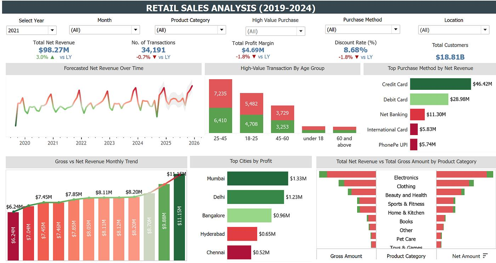

# Retail Sales Analysis Dashboard (2019–2024)

## Project Overview

The **Retail Sales Analysis Dashboard** presents an interactive view of retail sales performance across the 2019–2024 period. It brings together revenue, transaction, profit, discount, customer, product-category, purchase-method, age-group, and city-level views in one dashboard.

The dashboard screenshot currently shows **2021** selected. Users can change the available filters to explore different slices of the data.

## Dashboard Preview



> To display the preview on GitHub, upload the screenshot to the same repository as this README and keep its filename exactly `DASHBOARD.jpg` (including capital letters).

## Interactive Filters

The dashboard includes the following filters:

- **Select Year** – choose a year for analysis.
- **Month** – focus on a particular month or all months.
- **Product Category** – filter the dashboard by category.
- **High Value Purchase** – focus on high-value purchases.
- **Purchase Method** – compare payment/purchase methods.
- **Location** – filter results by location.

## Key Performance Indicators

The dashboard displays these KPI cards:

| KPI | Value shown in the supplied screenshot |
|---|---:|
| Total Net Revenue | $98.27M |
| No. of Transactions | 34,191 |
| Total Profit Margin | $4.69M |
| Discount Rate | 8.68% |
| Total Customers | $18.81B* |

\* **Verification required:** The card titled **Total Customers** displays `$18.81B` in the screenshot. This appears to be currency formatting or a metric/label mismatch. Confirm the underlying calculation and correct the title or number format before publishing this figure as a customer count.

The KPI values above are a visual transcription of the screenshot with **2021 selected**; they are not independently recalculated or validated here.

## Dashboard Visualizations

The dashboard contains six analysis sections:

1. **Forecasted Net Revenue Over Time** – displays the revenue trend and forecast period.
2. **High-Value Transaction by Age Group** – compares high-value transaction counts across age groups.
3. **Top Purchase Method by Net Revenue** – compares net revenue across purchase methods, including Credit Card, Debit Card, Net Banking, International Card, and PhonePe UPI.
4. **Gross vs Net Revenue Monthly Trend** – compares gross and net revenue across months.
5. **Top Cities by Profit** – ranks cities by profit.
6. **Total Net Revenue vs Total Gross Amount by Product Category** – compares net and gross amounts across product categories.

## Key Dashboard Capabilities

- Interactive filtering by year, month, product category, high-value purchase, purchase method, and location.
- KPI summary for key business measures.
- Time-based revenue trend and forecast view.
- Comparisons across customer age groups, purchase methods, cities, and product categories.
- Combined gross and net revenue analysis.

## Tools and Data

Add the exact tools and data source used in your project before publishing:

- **BI tool:** [Enter the tool used, e.g. Tableau / Power BI]
- **Dataset/source:** [Enter dataset name and source]
- **Data period:** 2019–2024 (as stated in the dashboard title)
- **Dashboard file or public link:** [Add your published dashboard URL, if available]

Do not leave these placeholders in the final public version. Only list tools, data sources, and calculations that you actually used.

## Business Questions Explored

This dashboard is designed to help explore questions such as:

- How does net revenue change over time?
- Which purchase methods contribute the most net revenue?
- Which age groups have more high-value transactions?
- Which cities generate the highest profit?
- How do gross and net revenue compare by month and product category?
- How do results change when the dashboard filters are applied?

## Repository Contents

After uploading your project materials, this repository may contain:

```text
Retail-Sales-Analysis/
├── README.md
├── DASHBOARD.jpg
└── [dashboard workbook / project files]
```

Replace the bracketed entry with the actual workbook or project filename you are sharing.

## Notes Before Publishing

- Upload the actual dashboard screenshot as `DASHBOARD.jpg` in the same GitHub repository as this README.
- Verify the **Total Customers** KPI: the screenshot shows `$18.81B` beneath that label.
- Confirm the meaning and calculation of **Total Profit Margin** and **High Value Purchase** so readers can interpret them correctly.
- Add the real BI tool name, dataset/source, and public dashboard link.
- Ensure the dashboard's displayed date range and forecast period are explained accurately.

## Author

[Add your name]
